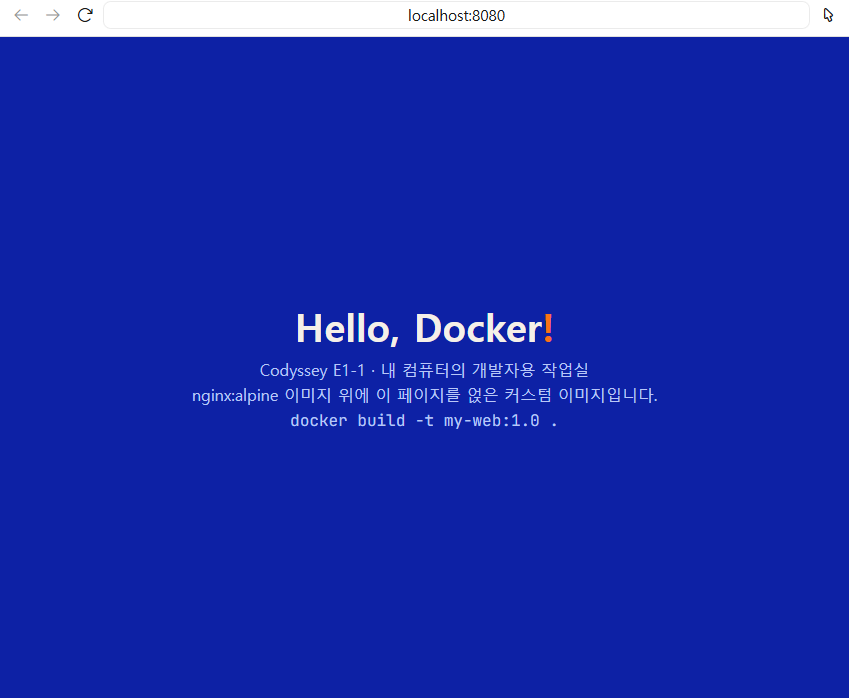
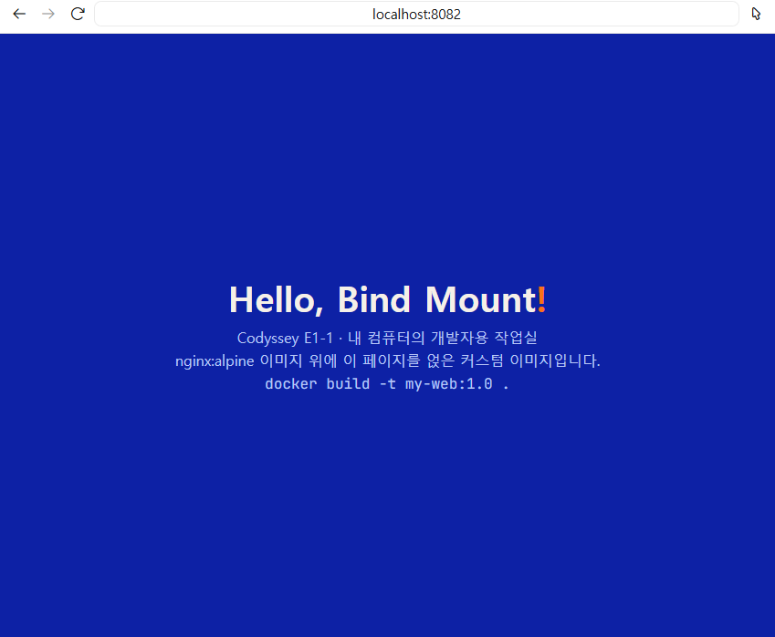
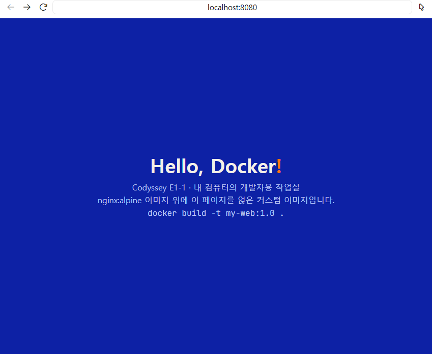
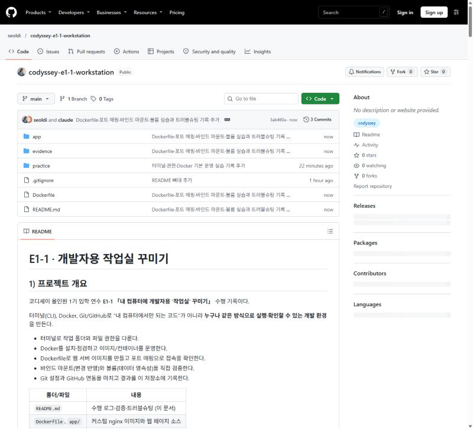
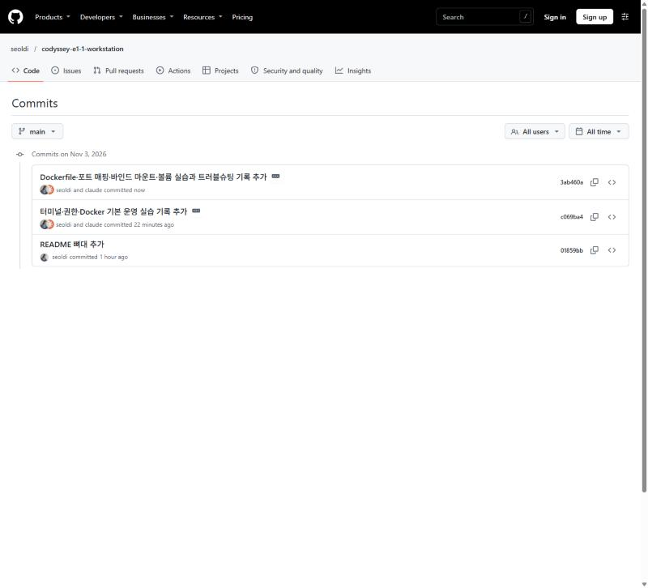
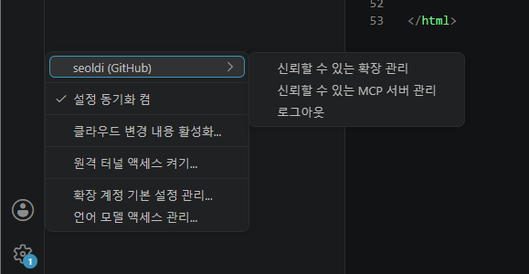
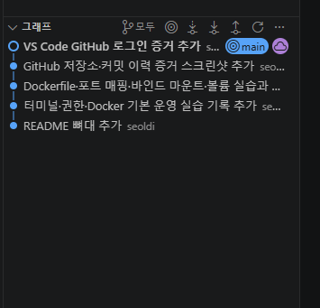

# E1-1 · 개발자용 작업실 꾸미기

## 1) 프로젝트 개요
코디세이 올인원 1기 입학 연수 **E1-1 「내 컴퓨터에 개발자용 '작업실' 꾸미기」** 수행 기록이다.

터미널(CLI), Docker, Git/GitHub로 "내 컴퓨터에서만 되는 코드"가 아니라 **누구나 같은 방식으로 실행·확인할 수 있는 개발 환경**을 만든다.

- 터미널로 작업 폴더와 파일 권한을 다룬다.
- Docker를 설치·점검하고 이미지/컨테이너를 운영한다.
- Dockerfile로 웹 서버 이미지를 만들고 포트 매핑으로 접속을 확인한다.
- 바인드 마운트(변경 반영)와 볼륨(데이터 영속성)을 직접 검증한다.
- Git 설정과 GitHub 연동을 마치고 결과를 이 저장소에 기록한다.

| 폴더/파일 | 내용 |
|---|---|
| `README.md` | 수행 로그·검증·트러블슈팅 (이 문서) |
| `Dockerfile`, `app/` | 커스텀 nginx 이미지와 웹 페이지 소스 |
| `practice/` | 터미널 조작 실습 파일 |
| `evidence/` | 브라우저 접속·화면 증거 스크린샷 |

## 2) 실행 환경
- OS: Windows 11 Home 10.0.26200 (Docker는 WSL 2 기반 Docker Desktop)
- Shell / 터미널: Windows PowerShell (VS Code 통합 터미널), 컨테이너 안은 bash(ubuntu)
- Docker: 29.9.2 (Docker Desktop 4.97.0)
- Git: 2.48.1.windows.1
- 에디터: VS Code

## 3) 수행 체크리스트
- [x] 터미널 기본 조작
- [x] 권한 변경 실습 (파일 1 · 디렉토리 1)
- [x] Docker 설치/점검
- [x] Docker 기본 운영 (images / ps / logs / stats)
- [x] hello-world · ubuntu 실습
- [x] Dockerfile 커스텀 이미지
- [x] 포트 매핑 접속
- [x] 바인드 마운트 반영
- [x] 볼륨 영속성
- [x] Git 설정 + VS Code GitHub 연동

## 4) 수행 로그 및 검증
### 4-1 터미널 조작
환경: Windows PowerShell (VS Code 터미널). 작업 폴더 `D:\20_Codyssey\10_미션\E1-1_workstation\practice`

| 작업 | 명령 |
|---|---|
| 현재 위치 확인 | `pwd` |
| 목록 확인(숨김 포함) | `ls -Force` |
| 이동 | `cd` |
| 생성 | `mkdir`, `New-Item` |
| 복사 | `cp` |
| 이동/이름변경 | `mv` |
| 삭제 | `rm` |
| 내용 확인 | `cat` |
| 빈 파일 생성 | `New-Item <파일> -ItemType File` |

```powershell
PS D:\20_Codyssey\10_미션\E1-1_workstation> pwd

Path
----
D:\20_Codyssey\10_미션\E1-1_workstation

PS D:\20_Codyssey\10_미션\E1-1_workstation> mkdir practice

    디렉터리: D:\20_Codyssey\10_미션\E1-1_workstation

Mode                 LastWriteTime         Length Name
----                 -------------         ------ ----
d-----      2026-11-03   오후 1:44                practice

PS D:\20_Codyssey\10_미션\E1-1_workstation> cd practice
PS D:\20_Codyssey\10_미션\E1-1_workstation\practice> pwd

Path
----
D:\20_Codyssey\10_미션\E1-1_workstation\practice

PS D:\20_Codyssey\10_미션\E1-1_workstation\practice> New-Item hello.txt -ItemType File

Mode                 LastWriteTime         Length Name
----                 -------------         ------ ----
-a----      2026-11-03   오후 1:45              0 hello.txt

PS D:\20_Codyssey\10_미션\E1-1_workstation\practice> echo "안녕 터미널" > memo.txt
PS D:\20_Codyssey\10_미션\E1-1_workstation\practice> ls

Mode                 LastWriteTime         Length Name
----                 -------------         ------ ----
-a----      2026-11-03   오후 1:45              0 hello.txt
-a----      2026-11-03   오후 1:45             18 memo.txt

PS D:\20_Codyssey\10_미션\E1-1_workstation\practice> cat memo.txt
안녕 터미널
PS D:\20_Codyssey\10_미션\E1-1_workstation\practice> cp memo.txt memo_copy.txt
PS D:\20_Codyssey\10_미션\E1-1_workstation\practice> mv memo_copy.txt renamed.txt
PS D:\20_Codyssey\10_미션\E1-1_workstation\practice> ls

Mode                 LastWriteTime         Length Name
----                 -------------         ------ ----
-a----      2026-11-03   오후 1:45              0 hello.txt
-a----      2026-11-03   오후 1:45             18 memo.txt
-a----      2026-11-03   오후 1:45             18 renamed.txt

PS D:\20_Codyssey\10_미션\E1-1_workstation\practice> rm renamed.txt
PS D:\20_Codyssey\10_미션\E1-1_workstation\practice> ls

Mode                 LastWriteTime         Length Name
----                 -------------         ------ ----
-a----      2026-11-03   오후 1:45              0 hello.txt
-a----      2026-11-03   오후 1:45             18 memo.txt

PS D:\20_Codyssey\10_미션\E1-1_workstation\practice> cd ..
PS D:\20_Codyssey\10_미션\E1-1_workstation> pwd

Path
----
D:\20_Codyssey\10_미션\E1-1_workstation
```

**숨김 파일 포함 목록 (`ls -Force`)**
```powershell
PS D:\20_Codyssey\10_미션\E1-1_workstation> ls -Force

    디렉터리: D:\20_Codyssey\10_미션\E1-1_workstation

Mode                 LastWriteTime         Length Name
----                 -------------         ------ ----
d--h-        2026-11-03  오후 1:36                .git
d----        2026-11-03  오후 1:46                practice
-a---        2026-11-03  오후 1:25            184 .gitignore
-a---        2026-11-03  오후 1:50           4551 README.md
```
`Mode`의 `h`가 숨김 속성이다. `.git`은 `-Force` 없이는 목록에 나타나지 않는다.

**관찰**
- `memo.txt`는 글자가 6자인데 18바이트다. PowerShell의 `>`는 파일을 UTF-16(BOM 포함)으로 저장하기 때문이다. 리눅스/Docker 안에서 같은 파일을 읽으면 글자가 깨질 수 있어, 이후에는 `Set-Content -Encoding utf8` 등으로 저장한다.
- `ls`, `cat`, `cp`, `mv`, `rm`은 PowerShell의 별칭(alias)이며 실제 리눅스 명령과 옵션이 다르다. (예: 숨김 파일은 리눅스 `ls -a`, PowerShell `ls -Force`)
### 4-2 권한 실습
Windows PowerShell에는 `chmod`가 없어서(권한 체계가 다름) 리눅스인 ubuntu 컨테이너 안에서 실습했다. 대상은 파일 1개(`file.txt`), 디렉토리 1개(`dir1`).

```bash
$ mkdir -p /tmp/perm && cd /tmp/perm && touch file.txt && mkdir dir1 && ls -ld file.txt dir1
drwxr-xr-x 2 root root 4096 Nov  3 05:17 dir1
-rw-r--r-- 1 root root    0 Nov  3 05:17 file.txt          # 변경 전 (기본값: 파일 644, 디렉토리 755)

$ chmod 600 file.txt && chmod 700 dir1 && ls -ld file.txt dir1
drwx------ 2 root root 4096 Nov  3 05:17 dir1
-rw------- 1 root root    0 Nov  3 05:17 file.txt          # 변경 후 (소유자만 접근)

$ chmod 777 file.txt && stat -c "%a %A %n" file.txt dir1
777 -rwxrwxrwx file.txt
700 drwx------ dir1
```

| 숫자 | 기호 | 의미 |
|---|---|---|
| 644 | `rw-r--r--` | 소유자 읽기·쓰기 / 그룹·기타 읽기 |
| 755 | `rwxr-xr-x` | 소유자 읽기·쓰기·실행 / 그룹·기타 읽기·실행 |
| 600 | `rw-------` | 소유자만 읽기·쓰기 |
| 700 | `rwx------` | 소유자만 읽기·쓰기·실행 |

- r=4, w=2, x=1을 자리별(소유자·그룹·기타)로 더한다. 7=4+2+1, 5=4+1, 6=4+2, 4=4.
- 디렉토리의 `x`는 "안으로 들어갈 수 있는 권한"이다.
- 절대 경로는 `/`부터 시작(`/tmp/perm/file.txt`), 상대 경로는 현재 위치 기준(`./file.txt`, `../dir1`)이다.

### 4-3 Docker 설치·점검
설치: 교안의 설치 스크립트로 Docker Desktop 설치 후 재시작.
```powershell
PS> docker --version
Docker version 29.9.2, build a82e528

PS> docker info          # 발췌
Server:
 Containers: 0
 Server Version: 29.9.2
 Storage Driver: overlayfs
 Kernel Version: 6.18.54.1-microsoft-standard-WSL2
 Operating System: Docker Desktop
 OSType: linux
 Architecture: x86_64
```
`docker info`가 Server 항목까지 출력되므로 Docker 데몬이 동작 중이다. 커널이 `microsoft-standard-WSL2`인 것은 Docker Desktop이 WSL 2 위에서 리눅스 엔진을 돌리기 때문이다.

### 4-4 Docker 운영
```powershell
PS> docker pull alpine
Status: Downloaded newer image for alpine:latest

PS> docker images
IMAGE           ID             DISK USAGE   CONTENT SIZE
alpine:latest   be2656061b53         13MB         3.94MB

PS> docker run -d --name web-test nginx
bdf1a70e81a9...

PS> docker ps
CONTAINER ID   IMAGE     COMMAND                  STATUS          PORTS     NAMES
bdf1a70e81a9   nginx     "/docker-entrypoint.…"   Up 3 seconds    80/tcp    web-test
67692a7ecc82   ubuntu    "bash"                   Up About a minute          u1

PS> docker logs web-test          # 발췌
/docker-entrypoint.sh: Configuration complete; ready for start up
nginx/1.31.8
start worker processes

PS> docker stats --no-stream
NAME       CPU %     MEM USAGE / LIMIT     MEM %     PIDS
web-test   0.00%     19.59MiB / 15.38GiB   0.12%     23

PS> docker stop web-test
PS> docker ps                     # 실행 중인 것만
CONTAINER ID   IMAGE     COMMAND   STATUS              NAMES
67692a7ecc82   ubuntu    "bash"    Up About a minute   u1

PS> docker ps -a                  # 중지된 것까지
NAMES         STATUS
web-test      Exited (0) Less than a second ago
u1            Up About a minute
musing_rosalind   Exited (0) About a minute ago

PS> docker rm web-test
PS> docker ps -a                  # web-test 삭제 확인
```
- `docker ps`는 실행 중만, `docker ps -a`는 중지된 컨테이너까지 보여 준다.
- 이름 없이 실행한 컨테이너(`hello-world`)는 Docker가 `musing_rosalind` 같은 임의 이름을 붙인다.
- `docker stats`는 `--no-stream`이 없으면 계속 갱신된다.

### 4-5 컨테이너 실행 실습
```powershell
PS> docker run hello-world
Hello from Docker!
This message shows that your installation appears to be working correctly.

PS> docker run -it --name u1 ubuntu bash
root@67692a7ecc82:/# 
```
ubuntu 컨테이너 내부 명령(`docker exec u1 ...`로 실행):
```bash
$ ls
bin  boot  dev  etc  home  lib  lib64  media  mnt  opt  proc  root  run  sbin  srv  sys  tmp  usr  var
$ echo hello
hello
$ pwd
/
```
**attach/exec 차이 관찰**
- `docker run -it ... bash`로 들어간 셸이 컨테이너의 **메인 프로세스(PID 1)** 다. 이 셸에서 `exit`하면 메인 프로세스가 끝나서 컨테이너도 중지된다.
- `docker exec`는 실행 중인 컨테이너에 **별도 프로세스**를 추가로 실행한다. 이 명령이 끝나도 컨테이너는 계속 실행 상태(`Up`)로 남는다. 실제로 셸이 열린 상태에서 `docker exec u1 ...`로 위 명령들을 실행해도 `u1`은 `Up`이었다.
- `docker attach`는 메인 프로세스의 입출력에 붙는 것이라, 거기서 `exit`하면 마찬가지로 컨테이너가 종료될 것이다. (이론 정리, 아직 직접 실행해 확인하지 않음)
### 4-6 커스텀 이미지 (Dockerfile)
**선택: (A) 웹 서버 베이스 이미지 활용 — `nginx:alpine` + 정적 콘텐츠 교체**

- 기존 베이스: `nginx:alpine` (nginx가 설치된 가벼운 alpine 리눅스 공식 이미지)
- 웹 서버 소스: [`app/index.html`](app/index.html)
- Dockerfile: [`Dockerfile`](Dockerfile)

```dockerfile
FROM nginx:alpine
LABEL org.opencontainers.image.title="my-custom-nginx"
ENV APP_ENV=dev
COPY app/ /usr/share/nginx/html/
```

| 커스텀 포인트 | 목적 |
|---|---|
| `FROM nginx:alpine` | 웹 서버를 직접 설치하지 않고 검증된 이미지를 재사용한다 |
| `COPY app/ /usr/share/nginx/html/` | nginx 기본 페이지를 내 페이지(`app/index.html`)로 교체한다 |
| `ENV APP_ENV=dev` | 설정값을 코드와 분리해 환경변수로 둔다 |
| `LABEL ...title` | 이미지가 무엇인지 식별하는 메타데이터를 남긴다 |

빌드와 확인:
```powershell
PS> docker build --progress=plain -t my-web:1.0 .
#1 [internal] load build definition from Dockerfile
#5 [1/2] FROM docker.io/library/nginx:alpine@sha256:785835ea65db...
#6 [2/2] COPY app/ /usr/share/nginx/html/
#7 naming to docker.io/library/my-web:1.0 done

PS> docker images my-web
IMAGE        ID             DISK USAGE   CONTENT SIZE
my-web:1.0   23aabf5d6a89       93.6MB         26.3MB

PS> docker image inspect my-web:1.0 --format 'Labels={{json .Config.Labels}}'
Labels={"maintainer":"NGINX Docker Maintainers <docker-maint@nginx.com>","org.opencontainers.image.title":"my-custom-nginx"}
```
(위 빌드 로그는 두 번째 실행이라 `COPY` 단계가 `CACHED`로 표시된다. 이미지 이름·라벨·환경변수 `APP_ENV=dev`가 적용된 것을 `docker image inspect`로 확인했다.)

### 4-7 포트 매핑
`-p <host_port>:<container_port>` 형식. nginx는 컨테이너 안에서 80 포트로 듣고, 내 컴퓨터의 8080·8081 포트로 각각 연결했다. 같은 이미지를 서로 다른 포트로 두 번 실행한다.

```powershell
PS> docker run -d -p 8080:80 --name my-web-8080 my-web:1.0
PS> docker run -d -p 8081:80 --name my-web-8081 my-web:1.0

PS> docker ps --format 'table {{.Names}}\t{{.Image}}\t{{.Ports}}\t{{.Status}}'
NAMES         IMAGE        PORTS                                     STATUS
my-web-8081   my-web:1.0   0.0.0.0:8081->80/tcp, [::]:8081->80/tcp   Up 24 seconds
my-web-8080   my-web:1.0   0.0.0.0:8080->80/tcp, [::]:8080->80/tcp   Up About a minute

PS> curl.exe -s -i http://localhost:8080 | Select -First 4
HTTP/1.1 200 OK
Server: nginx/1.31.8
Date: Tue, 03 Nov 2026 05:30:47 GMT
Content-Type: text/html

PS> curl.exe -s -i http://localhost:8081 | Select -First 4
HTTP/1.1 200 OK
Server: nginx/1.31.8
Date: Tue, 03 Nov 2026 05:30:47 GMT
Content-Type: text/html
```

브라우저 접속 (주소창 `localhost:8080`):



**포트 매핑이 필요한 이유**
- 컨테이너는 격리된 자기만의 네트워크 안에서 실행된다. 컨테이너 안의 80 포트는 내 컴퓨터 밖에서 바로 닿지 않는다.
- `-p 8080:80`은 "내 컴퓨터의 8080 포트로 오는 요청을 컨테이너의 80 포트로 전달하라"는 연결 규칙이다.
- 컨테이너 안은 모두 80 포트를 쓰지만, 호스트 포트를 다르게 주면 같은 이미지를 여러 개 동시에 띄울 수 있다. (8080과 8081)
### 4-8 바인드 마운트
내 컴퓨터의 `app` 폴더를 컨테이너의 nginx 웹 폴더에 연결해, **이미지를 다시 빌드하지 않고도** 파일 수정이 반영되는지 확인했다.

```powershell
PS D:\20_Codyssey\10_미션\E1-1_workstation> docker run -d -p 8082:80 --name my-web-mount -v "${PWD}/app:/usr/share/nginx/html" nginx:alpine
```
- `-v "${PWD}/app:/usr/share/nginx/html"`: 콜론 왼쪽은 내 폴더, 오른쪽은 컨테이너 안 경로.
- 베이스는 `nginx:alpine` 그대로이고 `my-web:1.0`이 아니다. 페이지는 이미지 안이 아니라 연결된 폴더에서 온다.

**마운트 확인**
```powershell
PS> docker inspect my-web-mount --format '{{json .Mounts}}'
[{"Type":"bind","Source":"D:\\20_Codyssey\\10_미션\\E1-1_workstation/app","Destination":"/usr/share/nginx/html","Mode":"","RW":true,"Propagation":"rprivate"}]

PS> docker exec my-web-mount ls -l /usr/share/nginx/html
-rwxrwxrwx    1 root     root          1036 Nov  3 05:34 index.html
```
`Type`이 `bind`이고 호스트의 `app` 폴더가 컨테이너 안 경로로 연결된 것을 볼 수 있다. 호스트 쪽에서 저장한 `index.html`이 컨테이너 안에 그대로 보인다.

**변경 전/후 비교**

호스트에서 `app/index.html`의 제목을 아래처럼 바꾸고 저장했다. 컨테이너 재시작·재빌드는 하지 않았다.
```diff
- <h1>Hello, Docker<span>!</span></h1>
+ <h1>Hello, Bind Mount<span>!</span></h1>
```

| | 컨테이너 | 연결 방식 | 결과 |
|---|---|---|---|
| 변경 전(기준) | `my-web-8080` (`my-web:1.0`) | `COPY`로 이미지 안에 복사 | `Hello, Docker!` |
| 변경 후 | `my-web-mount` (`nginx:alpine` + `-v`) | 바인드 마운트 | `Hello, Bind Mount!` |
| 변경 후 대조 | `my-web-8080` | `COPY`(이미지 안) | **그대로 `Hello, Docker!`** |

```powershell
PS> curl.exe -s http://localhost:8082 | Select-String '<h1>'
    <h1>Hello, Bind Mount<span>!</span></h1>

PS> curl.exe -s http://localhost:8080 | Select-String '<h1>'
  <h1>Hello, Docker<span>!</span></h1>
```

변경 후 `localhost:8082` (바인드 마운트, 수정 반영):



같은 시점 `localhost:8080` (COPY 방식, 수정 안 됨):



**정리**
- `COPY`는 빌드할 때 한 번 복사한다. 이미지가 복사본을 갖고 있어서 파일을 고치면 이미지를 다시 빌드해야 반영된다.
- 바인드 마운트는 복사가 아니라 **같은 폴더를 다른 주소로 보는 것**이다. 호스트에서 고치면 컨테이너에서 바로 바뀌고, 컨테이너 안에서 지우면 호스트에서도 지워진다. 그래서 개발 중 코드 수정 반영에 쓰고, 배포용 이미지는 `COPY`로 담는다.
- 변경 **전** 상태의 `8082`는 터미널에서 `curl.exe http://localhost:8082`로 확인했고 `<h1>Hello, Docker<span>!</span></h1>`가 출력됐다(수정 전 응답). 브라우저 캡처는 변경 후 것만 있어서, 변경 전은 같은 원본 페이지를 서비스하는 `8080` 화면을 기준으로 함께 제시했다.
### 4-9 볼륨 영속성
Docker가 관리하는 저장 공간(볼륨)을 컨테이너에 연결하고, **컨테이너를 삭제한 뒤 새 컨테이너에서 데이터가 유지되는지** 확인했다. 바인드 마운트와 달리 `-v` 콜론 왼쪽이 경로가 아니라 **이름**(`mydata`)이다.

**① 볼륨 생성**
```powershell
PS> docker volume create mydata
mydata
PS> docker volume ls
DRIVER    VOLUME NAME
local     mydata
```

**② 볼륨을 연결한 컨테이너에서 데이터 기록**
```powershell
PS> docker run -d --name vol-test -v mydata:/data ubuntu sleep infinity
aaae558f5355...
PS> docker exec vol-test bash -c "echo 'hi volume' > /data/hello.txt && cat /data/hello.txt"
hi volume
```

**③ 컨테이너 삭제 (삭제 전/후의 "삭제")**
```powershell
PS> docker rm -f vol-test
vol-test
PS> docker ps -a        # vol-test가 목록에 없다
```

**④ 새 컨테이너에 같은 볼륨 연결 → 데이터 확인**
```powershell
PS> docker run -d --name vol-test2 -v mydata:/data ubuntu sleep infinity
5f316c5d9fe3...
PS> docker exec vol-test2 bash -c "cat /data/hello.txt"
hi volume
```
컨테이너 `vol-test`는 삭제됐지만 `mydata` 볼륨의 `hello.txt`가 남아 새 컨테이너 `vol-test2`에서 그대로 읽혔다.

**⑤ 대조: 볼륨 없이 만든 컨테이너는 데이터가 사라진다**
```powershell
PS> docker run -d --name no-vol ubuntu sleep infinity
PS> docker exec no-vol bash -c "echo gone > /data-test.txt && cat /data-test.txt"
gone
PS> docker rm -f no-vol
PS> docker run -d --name no-vol2 ubuntu sleep infinity
PS> docker exec no-vol2 bash -c "cat /data-test.txt"
cat: /data-test.txt: No such file or directory
```

**⑥ 정리·확인**
```powershell
PS> docker rm -f vol-test2 no-vol2
PS> docker volume inspect mydata
[
    {
        "CreatedAt": "2026-11-03T05:37:10Z",
        "Driver": "local",
        "Mountpoint": "/var/lib/docker/volumes/mydata/_data",
        "Name": "mydata",
        "Scope": "local"
    }
]
```
컨테이너를 모두 지운 뒤에도 `mydata` 볼륨은 남아 있다(`Mountpoint`가 도커 관리 영역).

| | 바인드 마운트 (4-8) | 볼륨 (4-9) |
|---|---|---|
| `-v` 왼쪽 | 내 컴퓨터의 **폴더 경로** | 도커가 관리하는 **이름** |
| 데이터 위치 | 내가 아는 폴더 (직접 편집) | 도커 관리 영역 (`/var/lib/docker/volumes/...`) |
| 용도 | 개발 중 코드 수정 반영 | DB 같은 데이터 보존 |
| 컨테이너 삭제 시 | 폴더는 내 컴퓨터에 그대로 | 볼륨은 그대로(따로 지워야 함) |

### 4-10 Git · GitHub 연동
**Git 설정** (이메일은 공개 저장소라 가렸다)
```powershell
PS> git config --global user.name "seoldi"
PS> git config --global user.email "***@naver.com"
PS> git config --global init.defaultBranch main
PS> git config --list
core.autocrlf=true
credential.helper=manager
user.email=***@naver.com
user.name=seoldi
init.defaultbranch=main
remote.origin.url=https://github.com/seoldi/codyssey-e1-1-workstation.git
remote.origin.fetch=+refs/heads/*:refs/remotes/origin/*
branch.main.remote=origin
branch.main.merge=refs/heads/main
branch.main.vscode-merge-base=origin/main
```
- `user.name`·`user.email`은 로그인 정보가 아니라 **commit에 적히는 이름표**다.
- `--global`은 이 PC 모든 저장소 공통, 저장소 안(`--local`) 설정이 있으면 그쪽이 우선한다.
- `git config --list`에서 `init.defaultbranch`가 두 번 나온다. 먼저 나오는 `master`는 시스템 기본값이고, 나중에 나오는 `main`(내가 설정한 전역 값)이 적용된다. 뒤쪽 설정이 이긴다.
- `branch.main.vscode-merge-base` 항목은 VS Code가 이 저장소를 인식해 추가한 설정이다.

**GitHub 저장소 연동 (명령 로그)**
```powershell
PS> git remote -v
origin  https://github.com/seoldi/codyssey-e1-1-workstation.git (fetch)
origin  https://github.com/seoldi/codyssey-e1-1-workstation.git (push)

PS> git push
   01859bb..c069ba4  main -> main
```
GitHub 저장소 화면 — 로그아웃 상태(우측 상단 Sign in)의 브라우저에서 열어도 **Public**으로 보이고, 토픽 `codyssey`와 파일 목록이 보인다.



커밋 이력 (`main` 브랜치, 로컬에서 push한 커밋 3개):



**VS Code GitHub 로그인 증거**: VS Code 왼쪽 아래 Accounts 메뉴에 `seoldi (GitHub)` 계정이 로그인된 상태로 표시된다.



**VS Code 저장소 연동 증거**: 소스 제어(Source Control) 패널의 그래프 화면이다. 현재 브랜치 `main`과 원격(구름 아이콘, `origin/main`)이 같은 커밋 위치에 있고, 터미널에서 push한 커밋 이력이 그대로 보인다. 즉 VS Code가 이 폴더를 GitHub 원격 저장소와 연결된 저장소로 인식하고 있다.



> 토큰·인증 코드는 어디에도 기록하지 않았다. 로그인은 Git for Windows의 Credential Manager(`credential.helper=manager`)가 브라우저 인증으로 처리했다.

**Git vs GitHub**
- **Git**: 내 컴퓨터에 설치된 프로그램으로, 폴더 안 파일의 버전(commit)을 기록한다. 인터넷이 없어도 동작한다.
- **GitHub**: Git 기록을 올려 두는 인터넷 서비스(원격 저장소)다. 다른 컴퓨터에서 받아 이어서 하거나 협업하고, 코디세이는 여기에 올린 내용을 읽어 평가한다.

## 5) 트러블슈팅
### 문제 1. 의도하지 않은 폴더에서 `git init` → 상위 폴더 전체가 공개 저장소에 push됨
- 문제: 미션 폴더(`10_미션\E1-1_workstation`)가 아니라 상위 폴더 `D:\20_Codyssey`의 터미널에서 `git init`·`add`·`commit`·`push`를 실행했다. 상위 폴더의 모든 파일이 Public 저장소에 올라갔고, 거기에는 인증 정보가 든 설정 파일(`start.cmd`)도 있었다.
- 원인 가설: 명령을 입력하기 전에 **터미널 줄 맨 앞 경로**(현재 폴더)를 확인하지 않았다. 터미널이 상위 폴더에서 열려 있었다.
- 확인: `git remote -v`로 연결 주소를, `git log --oneline`과 `git show --stat HEAD`로 커밋에 들어간 파일 목록을, `git ls-remote origin`으로 원격 `main`의 해시가 로컬과 같은지(push 완료) 확인했다. `ls -Force`로 `.git` 폴더가 상위 폴더에 생긴 것도 확인했다.
- 해결/대안:
  1. 노출된 인증 키는 폐기·재발급을 요청해야 한다(저장소를 지워도 이미 복사됐을 수 있기 때문). *(요청 완료 여부는 아직 확인하지 못함 — 처리 후 이 줄 갱신)*
  2. GitHub 저장소를 삭제하고 같은 이름으로 새로 만들었다.
  3. 상위 폴더의 `.git`을 삭제하고, 미션 폴더 안에서만 `git init`부터 다시 시작했다.
  4. `.gitignore`에 `.env`, 키·토큰 파일, `start.cmd` 등을 추가했다.
  5. push 전에 `git add .` → **`git status`로 올라갈 파일을 먼저 확인**하는 습관을 만들었다. 새 저장소에는 `README.md`와 `.gitignore` 두 개만 올라간 것을 확인했다.
- 교훈: 명령을 치기 전에 창 제목·탐색기 폴더·터미널 줄 맨 앞 경로 **세 곳**을 확인한다. `--force`로 덮어쓰기보다, 방금 만든 저장소는 지우고 새로 만드는 쪽이 흔적이 적다.

### 문제 2. 컨테이너(리눅스) 안에서 Windows 경로로 `cd` 실패
- 문제: ubuntu 컨테이너 안에서 `cd D:\20_Codyssey\10_미션`을 입력하자 `bash: cd: ... No such file or directory`가 났다.
- 원인 가설: 컨테이너 안은 리눅스라서 `D:` 같은 드라이브가 없고, 경로 구분이 `\`가 아니라 `/`다. bash에서 `\`는 이스케이프 문자라 `D:20_Codyssey10_...`로 합쳐져 버린다.
- 확인: 줄 맨 앞이 `PS D:\...>`가 아니라 `root@67692a7ecc82:/#`인 것을 확인했다. 오류 메시지에 `D:20_Codyssey10_...`처럼 `\`가 사라진 경로가 찍혀 있었다.
- 해결/대안: `exit`로 컨테이너에서 나와 줄 맨 앞이 `PS ...>`인 것을 확인한 뒤 Windows 쪽에서 폴더를 이동했다. 컨테이너 안에서는 `/` 기준 경로(`/tmp/perm` 등)만 쓴다. 호스트 파일을 컨테이너에서 보려면 `-v`로 폴더를 연결해야 한다(4-8).

### 문제 3. PowerShell의 `>`로 만든 파일이 18바이트
- 문제: `echo "안녕 터미널" > memo.txt`로 만든 파일이 6글자인데 18바이트로 나왔다.
- 원인 가설: PowerShell 5.x의 `>`는 UTF-16(BOM 포함)으로 저장한다. 공백 포함 6글자×2 + BOM 2 + 줄바꿈 4 = 18바이트.
- 확인: `ls`의 `Length`가 18이었고, `cat`으로는 정상으로 보였다(PowerShell은 UTF-16을 읽는다).
- 해결/대안: 리눅스/컨테이너에서 읽을 파일은 `Set-Content memo.txt "..." -Encoding utf8`로 저장한다.

### 문제 4. 만들지 않은 컨테이너를 `docker rm`
- 문제: `docker rm web-test`에서 `Error response from daemon: No such container: web-test`가 났다.
- 원인 가설: `web-test` 컨테이너를 `docker run -d --name web-test nginx`로 먼저 만들지 않고 삭제 명령부터 실행했다.
- 확인: `docker ps -a`에 `web-test`가 없었다.
- 해결/대안: `docker run`으로 컨테이너를 만든 뒤 `ps → logs → stats → stop → ps -a → rm` 순서로 다시 실행했다(4-4).

## 6) 학습 정리
- **절대/상대 경로**: 절대 경로는 맨 꼭대기(`/` 또는 `D:\`)부터 전부 적는다(`/tmp/perm/file.txt`, `D:\20_Codyssey\10_미션\...`). 상대 경로는 **지금 위치 기준**이다(`./file.txt`, `../dir1`, `practice`). `cd practice`가 되는 것은 지금 위치 아래에 `practice`가 있기 때문이다.
- **권한 r/w/x · 755/644**: r=읽기(4), w=쓰기(2), x=실행(1)이고, 소유자·그룹·기타 세 자리로 각각 더해서 쓴다. `755`=소유자 rwx, 그룹·기타 r-x. `644`=소유자 rw-, 그룹·기타 r--. 디렉토리의 `x`는 안으로 들어갈 수 있는 권한이다. (4-2)
- **포트 매핑이 필요한 이유**: 컨테이너는 격리된 자기 네트워크 안에서 돈다. `-p 호스트:컨테이너`로 내 컴퓨터의 포트와 컨테이너 포트를 이어 줘야 브라우저로 접속할 수 있고, 호스트 포트를 다르게 주면 같은 이미지를 여러 개 띄울 수 있다. (4-7)
- **볼륨**: 컨테이너 삭제와 상관없이 데이터를 보존하는, 도커가 관리하는 저장 공간이다. 바인드 마운트는 내 폴더 경로를 연결하고, 볼륨은 이름으로 연결한다. (4-8, 4-9)
- **Git vs GitHub**: Git은 내 컴퓨터의 버전 기록 프로그램, GitHub는 그 기록을 올려 두고 협업하는 원격 서비스다. (4-10)
- **COPY vs 바인드 마운트**: `COPY`는 빌드 시 이미지에 복사해 담고(배포용), 바인드 마운트는 같은 폴더를 연결해 수정이 바로 보인다(개발용). (4-6, 4-8)

## 7) 검증 방법 및 증거 위치
| 항목 | 무엇을 확인했나 | 사용한 명령 | 증거 위치 |
|---|---|---|---|
| 터미널 조작 | 이동·생성·복사·이름변경·삭제·내용 확인, 숨김 파일 표시 | `pwd`, `ls -Force`, `mkdir`, `cp`, `mv`, `rm`, `cat` | [4-1](#4-1-터미널-조작), `practice/` |
| 권한 | 변경 전/후 권한 문자열이 달라짐 | `ls -ld`, `chmod 600/700/777`, `stat` | [4-2](#4-2-권한-실습) |
| Docker 설치·데몬 | 버전과 서버(데몬) 응답 | `docker --version`, `docker info` | [4-3](#4-3-docker-설치점검) |
| 이미지·컨테이너 운영 | 목록, 로그, 리소스, 중지 상태 구분 | `docker images`, `ps`, `ps -a`, `logs`, `stats` | [4-4](#4-4-docker-운영) |
| hello-world · ubuntu | 설치 정상 메시지, 컨테이너 내부 명령, exec/종료 차이 | `docker run hello-world`, `docker run -it ubuntu bash`, `docker exec` | [4-5](#4-5-컨테이너-실행-실습) |
| 커스텀 이미지 | 빌드 성공, 라벨·환경변수 적용 | `docker build`, `docker image inspect` | [4-6](#4-6-커스텀-이미지-dockerfile), `Dockerfile`, `app/` |
| 포트 매핑 | 두 포트(8080, 8081)에서 HTTP 200 | `docker run -p`, `curl.exe -i` | [4-7](#4-7-포트-매핑), `evidence/01-port-8080-browser.png` |
| 바인드 마운트 | 호스트 수정이 재빌드 없이 반영, COPY 방식은 그대로 | `docker run -v 경로:경로`, `docker inspect`, `curl.exe` | [4-8](#4-8-바인드-마운트), `evidence/02-…`, `03-…` |
| 볼륨 영속성 | 컨테이너 삭제 후에도 데이터 유지, 볼륨 없으면 소실 | `docker volume create`, `docker run -v 이름:경로`, `docker rm -f` | [4-9](#4-9-볼륨-영속성) |
| Git·GitHub·VS Code | 설정값, 원격 연결, 로그인·소스 제어 상태 | `git config --list`, `git remote -v`, `git push` | [4-10](#4-10-git--github-연동), `evidence/04-…`~`07-…` |

## 8) 재현 방법 (평가자용)
Docker Desktop이 실행 중이면 저장소만 받아 같은 결과를 확인할 수 있다.

```powershell
git clone https://github.com/seoldi/codyssey-e1-1-workstation.git
cd codyssey-e1-1-workstation

# 4-6, 4-7: 이미지 빌드 후 포트 매핑 접속
docker build -t my-web:1.0 .
docker run -d -p 8080:80 --name my-web-8080 my-web:1.0
curl.exe -i http://localhost:8080        # HTTP/1.1 200 OK, 브라우저는 http://localhost:8080

# 4-8: 바인드 마운트 (app/index.html을 고치면 재빌드 없이 반영)
docker run -d -p 8082:80 --name my-web-mount -v "${PWD}/app:/usr/share/nginx/html" nginx:alpine

# 4-9: 볼륨 영속성
docker volume create mydata
docker run -d --name vol-test -v mydata:/data ubuntu sleep infinity
docker exec vol-test bash -c "echo 'hi volume' > /data/hello.txt"
docker rm -f vol-test
docker run --rm -v mydata:/data ubuntu cat /data/hello.txt   # hi volume

# 정리
docker rm -f my-web-8080 my-web-mount
docker volume rm mydata
```

**개인 PC에 묶인 부분 / 주의**
- 로그의 경로(`D:\20_Codyssey\10_미션\E1-1_workstation`)와 한글 폴더명(`10_미션`)은 내 PC 기준이다. 어디에 clone해도 된다.
- 명령은 Windows PowerShell 기준이다(`${PWD}`, `curl.exe`). macOS/Linux bash에서는 `${PWD}` 대신 `$(pwd)`, `curl.exe` 대신 `curl`을 쓴다.
- 포트 8080·8081·8082가 이미 쓰이고 있으면 `-p` 앞쪽 숫자를 다른 포트로 바꾼다.
- 권한 실습(4-2)은 `ubuntu` 컨테이너 안에서 하므로 `docker run -it ubuntu bash`로 들어가 같은 명령을 실행하면 된다.
